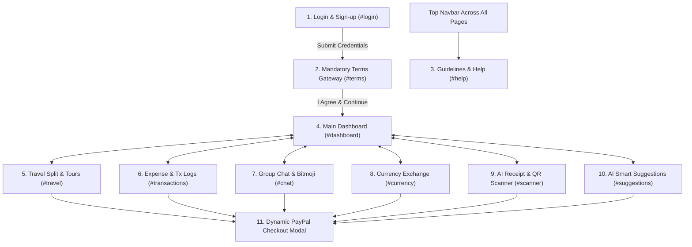

# SplitSmart 💳✨
> **A minimal, modern, and fully responsive multi-page fintech expense-sharing mobile web application powered by a professional PayPal-inspired blue theme (`#003087` deep navy & `#0070BA` brand blue accent).**

---

## 🚀 Live Demo & Local Access

SplitSmart is currently live and served locally at:
**[http://localhost:8080](http://localhost:8080)**

If restarting the local server, run:
```bash
cd C:\Users\angel\.gemini\antigravity\scratch\splitsmart-app
python serve.py
```
Or open `index.html` directly in any web browser!

---

## 🎨 Design System & Brand Identity

- **Sleek S$ Logo Branding**: Custom geometric SVG representing peer-to-peer splitting (dual interlocking payment arcs) and currency settlement (`S$` mark), featured prominently across **ALL** navigation headers and onboarding flows.
- **PayPal Blue Palette**:
  - Primary Deep Navy: `#003087`
  - Brand Accent Blue: `#0070BA`
  - PayPal Smart Button Gold: `#FFC439`
  - Canvas Background: `#F5F7FA`
  - Success Green: `#00875A`
  - Alert Red (Owed): `#D9381E`
- **Mobile-First App Shell**:
  - Touch-optimized sticky bottom navigation bar with floating elevated **Split AI** action button.
  - Safe area insets for iOS & Android devices.
  - Expands to desktop multi-column dashboard with side-by-side analytics.

---

## 📱 Interconnected Modules & User Flow



---

### 1. Login / Sign-up Page (`#login`)
- Clean fintech input fields with one-click **Demo Auto-fill** (`alex.j@splitsmart.io` / `paypal123`).
- Tab switching between *Sign In* and *Create Account*.
- Secure PayPal 256-bit SSL trust badge.
- **Mandatory Flow**: Submitting credentials immediately leads to the Terms & Policy Gateway.

### 2. Terms & Policy Gateway Page (`#terms`) *(Mandatory Step)*
- Dedicated compliance gateway appearing right after authentication.
- Detailed legal & fintech policies: Peer-to-Peer Split Policy, PayPal Direct Settlement & API Authorization, Sensitive Financial Data Encryption, and Anti-Fraud Protection.
- Mandatory **"I Agree & Continue"** checkbox.
- The **"Proceed to App Dashboard"** button remains locked until the user accepts, after which it illuminates with active PayPal styling and unlocks the application.

### 3. Guidelines & Help Center (`#help`)
- Accessible from the top navbar across every page via the help `?` icon.
- 4-step quickstart visual guide explaining groups, adding expenses, AI minimization, and PayPal checkout.
- Interactive FAQ accordions addressing security, zero platform fees, and OCR parsing.
- Direct link to SplitSmart live support.

### 4. Main Dashboard & Personal Data Bank Security (`#dashboard`)
- Metric summary cards: **"Total Net Balance"**, **"You Owe"** ($68.50), and **"You Are Owed"** ($142.00).
- **Personal Data & Bank Details Security Gate**:
  - Sensitive financial records (Chase Checking `•••• •••• •••• 4829`, ABA routing `•••• 0210`, verified PayPal email, available withdrawal balance) are **masked and encrypted by default**.
  - Enter your account PIN (Demo: `1234`) or click the quick-fill button to unmask and reveal real numbers.
  - Includes a one-click **"Mask & Re-lock"** action anytime.
- Quick-launch grid leading to all 6 specialized modules.
- Global **"Settle All Dues"** trigger.

### 5. Travel Split & Tour Management (`#travel`)
- **Trip Dashboard**: Features active tour *"Goa Vacation 2026"* with live budget progress bar ($1,480 spent of $2,500 budget), currency indicator, and member counts.
- **Who Owes Whom & 1-Click PayPal Settlement**:
  - Clear list of member debts (Rahul owes You $85.00, You owe Priya $45.00).
  - Prominent blue **"Pay with PayPal $45.00"** button next to pending items that automatically pre-loads the exact amount without manual typing.
- **Expense Addition & Currency Conversion**:
  - Add expenses for *Hotel, Cabs, Food, Sightseeing, Flights*.
  - Live currency conversion (USD to INR / EUR to INR at real-time rates).
  - Multi-member split selectors: **Equal Share (25% each)**, **Percentage Share**, or **Custom Share**.

### 6. Money Expense & Transaction History (`#transactions`)
- **Analytics Cards**: Total Monthly Spend ($1,842.50), Pending Settlements ($68.50), Cleared Transactions ($2,410.00).
- **Interactive Search & Filter Bar**:
  - Real-time keyword search by title, group, or payer name.
  - Multi-category chips (*Trips*, *Roommates*, *Hangouts*).
  - Status toggle (*All*, *Pending/Owed*, *Settled*).
- **Expandable Transaction Cards**:
  - Click any transaction to reveal the full member breakdown and payment status.
  - Direct blue **"Settle Up"** PayPal button on pending records.
- **Export Actions**: Download simulated CSV expense reports or generate printable PDF statements.

### 7. Group Chat & Bitmoji Expense Messaging (`#chat`)
- **Group Switcher**: Toggle between active groups (*Flat 302 Roommates*, *Goa Vacation 2026*, *Friday Hangouts*).
- **Interactive Message Stream**:
  - Text messages and custom fintech **Bitmoji stickers** (*Paid Bill 🍕💸*, *Settle Up 🤝💰*, *Reminder ⏰🔔*, *Thank You 🎉🙏*, *OMG Broke 😱💸*).
- **System Expense Cards**:
  - Embedded directly inside the chat feed when members add a bill.
  - Previews split breakdown and features a direct blue **"Pay with PayPal $15.00"** button for immediate settlement inside chat.
- **Dock & Sticker Drawer**: Quick Bitmoji sticker picker drawer and in-chat expense creator.

### 8. Currency Exchange Tool (`#currency`)
- **Live Rate Ticker Tape**: Scrolling real-time rates for `USD`, `INR`, `EUR`, `GBP`, `AED`, `CAD`.
- **Live Rate Calculator**:
  - Dual currency dropdown selectors with quick **"Swap Currencies"** button.
  - Real-time conversion display with zero foreign markup badge and fee savings comparison.
- **Split Converted Amount**:
  - Automatically calculates each traveler's converted share (e.g., INR 3,744.00 ≈ $45.00 USD each).
  - Integrated blue **"Pay with PayPal $45.00 USD"** button pre-loaded with the final converted amount.

### 9. Split Money (AI Receipt Scanner & QR Code) (`#scanner`)
- **Dual Mode Tabs**: *Scan Receipt (AI OCR)* vs *Scan QR Code*.
- **Interactive Scanning Animation**:
  - Animated laser sweep and neural OCR status indicator.
  - Includes quick 1-click sample receipts (*Bistro Dinner $48.00*, *Grocery Run $76.40*).
  - Natural language prompt parser (e.g., *"Split $120 dinner bill between Rahul and me"*).
- **Extracted Line-Item Card**:
  - Structured extraction table showing individual items (*Margherita Pizza $25.00*, *Craft Drinks $15.00*, *Tax & Tip $8.00*).
  - Member share calculation ($16.00 each) with direct blue **"Pay Your Share with PayPal ($16.00)"** button.
- **QR Code Viewfinder**: Camera reticle simulation with instant scan-to-pay trigger.

### 10. AI Smart Suggestions & Instant Settlement (`#suggestions`)
- **Neural Insights Banner**: Personalized AI tip highlighting frequent co-spenders.
- **Categorized Suggestion Cards**:
  - *Frequently Paid Friends*: Top contacts with pending balances.
  - *Recurring Expense Reminders*: Upcoming bills (e.g., Apartment rent due in 2 days $300.00).
  - *Smart Balance Optimization*: Debt simplification algorithm (pay 1 person instead of 3).
- **1-Click Settlement**: Every suggestion card includes a prominent blue **"Pay with PayPal"** button pre-loaded with the exact suggested amount.
- Dismiss cards with smooth fade out.

### 11. Dynamic PayPal Checkout Flow (Universal Modal)
- **Zero Manual Amount Typing**: Auto-loads the exact dynamic amount (e.g., $45.00, $16.00, $23.50, $300.00) from whatever button was clicked.
- **Realistic PayPal UI**:
  - Recipient profile and verification badge.
  - Zero-fee peer-to-peer guarantee breakdown.
  - Payment source selection: PayPal Balance vs Linked Chase Checking account.
  - Dual PayPal action buttons: Official PayPal Gold button and Blue Card button.
- **Simulated Gateway Processing**: Realistic cryptographic authorization spinner.
- **Success Receipt**: Generates realistic PayPal Transaction ID (`PP-XXXXXXXX-TX`), updates balances throughout the app in real time, and offers a downloadable official text receipt.

---

## 🛠️ Tech Stack & Architecture

- **Frontend**: Modular Semantic HTML5, Modern CSS3 (Flexbox & CSS Grid, Custom Properties, Fluid Typography), Vanilla JavaScript ES6+.
- **Icons**: FontAwesome 6 + Custom Vector SVGs.
- **Branding**: Official PayPal Color Scheme (`#003087`, `#0070BA`, `#FFC439`) + Custom `S$` Vector Logo.
- **State Management**: Reactive state store (`state.js`) with automatic `localStorage` synchronization.
- **Routing**: Single Page Application client-side hash router (`router.js`) with strict route guards for login and terms enforcement.
